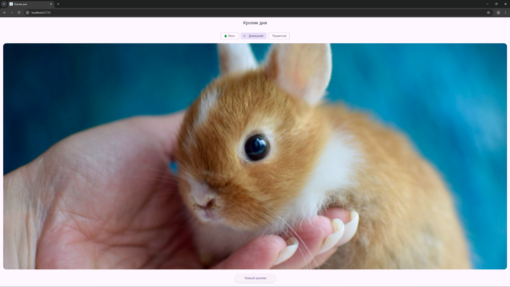

# Кролик дня (Rabbit of the Day)

Приложение на Flutter, которое асинхронно загружает случайные фотографии кроликов. Демонстрирует работу с `Future`, `async/await` и индикатором загрузки.

## Автор

Морозов Владислав, группа ИСП-243

## Стек и версии
- Dart 3.x
- Платформа: Web (Chrome)

## Скриншот



## Как это работает

При нажатии на кнопку вызывается асинхронный метод `_fetchPhoto()`. Он использует `await Future.delayed()` для имитации сетевой задержки в 2 секунды, показывая пользователю `CircularProgressIndicator`. После задержки выбирается случайное локальное изображение кролика, и UI обновляется через `setState()`.

## Как запустить

```bash
git clone https://github.com/qwezxc228/Flutter_photo_of_the_day.git
cd photo_of_the_day_morozov
flutter pub get
flutter run -d chrome